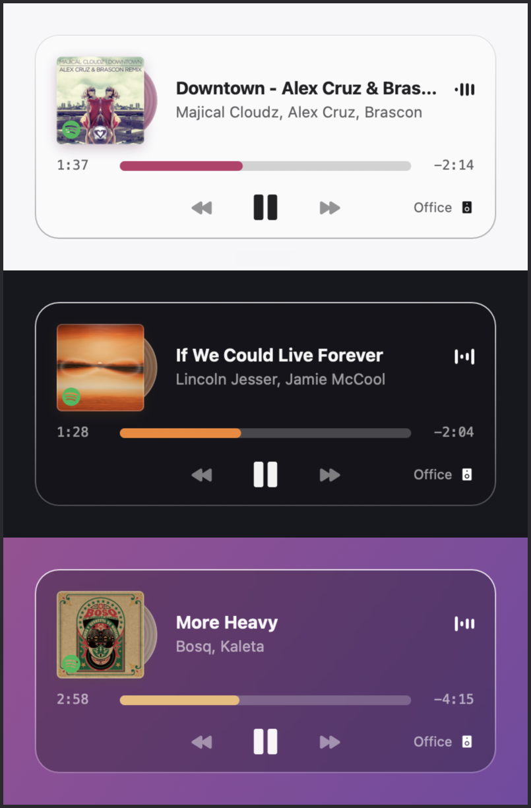

# SpotifyKnob

A Hammerspoon Spoon that turns a cheap USB volume knob into a Spotify Connect
controller, with a now-playing card that appears when you touch it.

Built for the [Anticater VK-01](https://anticater.com), but the hardware is
interchangeable — anything you can program to emit `F16`–`F20` will drive it.



*Three backdrops, three records. The card photographs whatever is behind it and
measures that to pick its material, so it stays legible on a white document and
on a dark desktop without you configuring anything. The vinyl and the progress
bar take their colour from the artwork — crimson, orange, sand — because it is
the same extracted colour driving both.*

## What it does

- **Volume reaches your actual speaker.** Not the Mac's output — the knob drives
  the volume of whichever Spotify Connect device is playing, over the Web API.
- **A card that knows what's on**: cover art, title, artist, elapsed and
  remaining, and the output device.
- **Adaptive glass.** The card photographs and blurs whatever is behind it, then
  measures that to pick light or dark material, so it stays legible on a white
  document and on a dark desktop alike.
- **A record**, tinted from the cover's own colour and translucent like coloured
  vinyl — opaque black when the sleeve is dark, as a real pressing would be.
- **Your keyboard's volume keys are untouched.** The knob and the keyboard drive
  different things, permanently.

## Why a knob and not the media keys

Out of the box the VK-01 emits `SOUND_UP` / `SOUND_DOWN` / `MUTE` at pid 0 —
byte-identical to what your keyboard sends. There is no way to tell them apart
at the event level, so intercepting those would hijack the keyboard too.

Instead the knob is reprogrammed to send `F16`–`F20`, which nothing else on
macOS claims. That keeps the two input paths genuinely separate.

## Requirements

- macOS with [Hammerspoon](https://www.hammerspoon.org)
- Python 3 (system Python is fine)
- Spotify **Premium** — the Web API's playback endpoints require it
- A knob that can be programmed to send F-keys

## Setup

### 1. Spotify credentials

Create an app at the [Spotify developer
dashboard](https://developer.spotify.com/dashboard) and add
`http://127.0.0.1:8888/callback` as a redirect URI.

Credentials go in the macOS Keychain, never in a file:

```bash
security add-generic-password -s spotify-knob -a client_id     -w 'YOUR_ID'
security add-generic-password -s spotify-knob -a client_secret -w 'YOUR_SECRET'
```

Then authorise once:

```bash
~/.hammerspoon/Spoons/SpotifyKnob.spoon/spotify-connect.py auth
```

The refresh token is stored in the Keychain too. Nothing sensitive is ever
written to the repo or to your Hammerspoon config.

### 2. Program the knob

Connect it over **USB-C** — most of these knobs can only be reflashed while
wired, even if they run over Bluetooth afterwards. In the vendor's config app,
map:

| Gesture | Send |
|---|---|
| Turn left | `F17` |
| Turn right | `F18` |
| Press | `F16` |
| Long press + turn left | `F19` |
| Long press + turn right | `F20` |

Save to the device. The mapping lives on the knob, so it survives reboots and
works over Bluetooth — but a factory reset wipes it.

### 3. Install

```bash
git clone https://github.com/agustinlinenberg/spotify-knob
cp -r spotify-knob/SpotifyKnob.spoon ~/.hammerspoon/Spoons/
```

In your `~/.hammerspoon/init.lua`:

```lua
hs.loadSpoon("SpotifyKnob")
spoon.SpotifyKnob.connectDevice = "Office"   -- your speaker's name
spoon.SpotifyKnob:start()
```

## Configuration

| Property | Default | What it does |
|---|---|---|
| `connectDevice` | `nil` | Substring matched against your Connect device names. Unset follows whatever is active. |
| `step` / `fineStep` | `4` / `1` | Volume points per detent. Shift inverts which one you get. |
| `dwell` | `3.4` | Seconds the card stays up. |
| `vinyl` | `true` | Draw the record behind the cover. |
| `spinRate` | `0.42` | How fast the record's highlight travels, as a fraction of true platter speed. See below. |
| `clickable` | `false` | Let the mouse work the transport. Off because skip lives on the knob, and a clickable card swallows clicks underneath it. |

Rebinding, if your hardware sends something else:

```lua
spoon.SpotifyKnob:bindHotkeys({
  turnDown = {{}, "f17"}, turnUp = {{}, "f18"}, playPause = {{}, "f16"},
  prev = {{}, "f19"}, next = {{}, "f20"},
  moveToSpeaker = {{"ctrl","alt","cmd"}, "s"},
})
```

## Notes on a couple of decisions

**`spinRate` is not physically accurate, on purpose.** A real record's specular
highlights barely move: the lamp and your eye are fixed, so the reflection sits
still while the disc turns underneath it, and what you actually see rotating is
the label. Since the label is hidden behind the sleeve here, modelling that
faithfully produces a disc that looks parked. `0.42` is tuned to be read rather
than to be right — about one revolution every four seconds, fast enough to
notice and slow enough that it never strobes.

**The card appears instantly and fades out.** No entrance animation: the knob is
direct physical manipulation used dozens of times a day, and any fade on the way
in reads as lag rather than polish. Leaving is the system retiring on its own,
so that one is allowed to take its time.

**Volume and play/pause answer locally and reconcile afterwards.** The Web API
round-trip is 300–500ms; waiting for it made every press feel dead and invited a
second press that undid the first.

## Limitations

- **Spotify Premium only**, and the API has no push, so the card only appears
  when you touch the knob — it can't announce a track change on its own.
- **The equaliser bars and the record's highlight are not driven by audio.**
  Spotify exposes no stream. They mean "sound is coming out of this", which is
  what the idiom means everywhere; they are not a spectrum.
- The blurred backdrop is a screen grab, so Hammerspoon needs Screen Recording
  permission. Without it the card falls back to a solid fill.

## Third-party assets

Icons in `SpotifyKnob.spoon/icons/` are from
[Phosphor](https://phosphoricons.com), MIT licensed, recoloured for the light
and dark materials. Phosphor's licence is included at
[icons/LICENSE](SpotifyKnob.spoon/icons/LICENSE).

## License

MIT — see [LICENSE](LICENSE).
